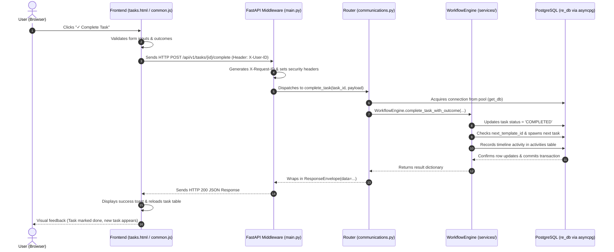

# 01. Beginner Developer Guide: How to Understand This Codebase
### دليل المطور المبتدئ لفهم بنية وهندسة النظام

Welcome! If you are a beginner developer or new to this codebase, reading thousands of lines of code can feel intimidating. This guide is written specifically to demystify every concept and show you exactly how the pieces of **RECRM** fit together, connecting theory to the actual files in this repository.

---

## 1. The Core Concepts Explained with RECRM Examples

### A. What is a "Frontend"?
The **frontend** is everything the user sees, clicks, and interacts with in their web browser. It displays tables of data, forms to enter new leads, buttons to complete tasks, and warning dialogs.
- **Where it lives in RECRM**: The [`src/ui/`](file:///home/nemro/RECRM/src/ui) directory.
- **How it is built here**: Many modern web apps use complex tools like React, Vue, or Angular that require compiling and bundling. RECRM uses **Pure Semantic HTML5, CSS3, and Vanilla JavaScript**. When you open [`src/ui/leads.html`](file:///home/nemro/RECRM/src/ui/leads.html), you are looking at standard HTML with inline JavaScript that runs directly in the browser without any build tools.

### B. What is a "Backend"?
The **backend** is the brain that runs behind the scenes on the server. It listens for requests from the frontend, checks security permissions, calculates mathematical formulas, validates data, and communicates with the database.
- **Where it lives in RECRM**: The [`src/backend/`](file:///home/nemro/RECRM/src/backend) directory.
- **How it is built here**: It is written in **Python** using the **FastAPI** web framework. The server is launched by [`src/backend/run.py`](file:///home/nemro/RECRM/src/backend/run.py), which starts an ASGI web server called **Uvicorn** listening on port `8000`.

### C. What is an "API" and an "Endpoint"?
**API** stands for *Application Programming Interface*. Think of the frontend as a restaurant customer looking at a menu, the backend as the kitchen, and the API as the waiter carrying orders back and forth.
An **Endpoint** is a specific address (URL) on the backend that handles a specific action. For example:
- `GET /api/v1/customers`: "Waiter, please bring me a list of all customers."
- `POST /api/v1/leads`: "Waiter, please create this new lead in the kitchen."
- `POST /api/v1/tasks/task-102/complete`: "Waiter, mark task #102 as complete with outcome CONNECTED."

### D. What is a "Database"?
A **database** is a dedicated software program designed to store, organize, search, and protect permanent business data so that nothing is lost when the server restarts.
- **Technology used in RECRM**: **PostgreSQL** (running on port `5432`).
- **How the backend talks to it**: Unlike many Python projects that use heavy Object-Relational Mappers (ORMs) like Django ORM or SQLAlchemy ORM, RECRM uses **`asyncpg`** ([`src/backend/app/database.py`](file:///home/nemro/RECRM/src/backend/app/database.py)). `asyncpg` is a fast asynchronous PostgreSQL driver that executes direct, parameterized SQL queries (e.g. `SELECT * FROM leads WHERE lead_id = $1`).

### E. What is a "Component"?
A **component** is a reusable visual or functional element. In this project:
- The **Toast Notification System** in [`src/ui/common.js`](file:///home/nemro/RECRM/src/ui/common.js#L38) (`showToast("تم الحفظ بنجاح", "success")`) creates floating alert banners.
- The **Confirmation Modals** (like `#modal-cancel-task` in [`src/ui/tasks.html`](file:///home/nemro/RECRM/src/ui/tasks.html#L1691)) are pop-up dialogs that stop the user and ask for confirmation before dangerous actions.

### F. What is a "Service"?
A **service** is a Python class or file containing the core business rules of your application, separated from the HTTP routing logic.
- In RECRM, the main service is [`WorkflowEngine`](file:///home/nemro/RECRM/src/backend/app/services/workflow_engine.py). It knows what task should be created when a lead qualifies, how to calculate reservation expiry, and how to cancel a deal.
- Mathematical logic lives in [`CalculationService`](file:///home/nemro/RECRM/src/backend/app/services/calculation_service.py) (e.g. calculating rental yields and broker commissions).
- Document generation logic lives in [`DocumentTemplates`](file:///home/nemro/RECRM/src/backend/app/services/document_templates.py) (e.g. rendering ZATCA invoices and Taqeem reports).

### G. What is a "Model" or "Schema"?
In FastAPI and Python, a **schema** (or Pydantic model) is a formal contract that defines what data is expected to enter or leave an API endpoint.
- For example, in [`src/backend/app/schemas/leads.py`](file:///home/nemro/RECRM/src/backend/app/schemas/leads.py), `LeadCreateIn` specifies that when creating a lead, `customer_id` is a required string, `inquiry_type` must be `'RENT'`, `'BUY'`, or `'INVEST'`, and `budget_max` must be a positive number. If the frontend sends text instead of a number, Pydantic immediately rejects it with a clear error.

### H. What is a "Controller" or "Route Handler"?
In FastAPI, these are Python functions decorated with `@router.get(...)` or `@router.post(...)` inside [`src/backend/app/routers/`](file:///home/nemro/RECRM/src/backend/app/routers).
- Their job: Receive the HTTP request from the browser, extract headers and query parameters, ask the database for a connection, invoke the relevant service, and return a clean JSON response.

### I. What is "Middleware"?
**Middleware** is code that runs automatically on *every single request* before it reaches your route handler, and on *every single response* before it leaves the server.
- In [`src/backend/app/main.py`](file:///home/nemro/RECRM/src/backend/app/main.py#L73), the middleware `add_correlation_id_and_security_headers` attaches a unique `X-Request-ID` to trace every transaction, injects security headers like `X-Frame-Options: SAMEORIGIN`, and disables aggressive browser caching on UI files.

### J. What is "Authentication" vs. "Authorization"?
- **Authentication ("Who are you?")**: Identifying the user. In RECRM, the frontend passes the user's ID in the `X-User-ID` header (managed by [`src/ui/user_session.js`](file:///home/nemro/RECRM/src/ui/user_session.js)).
- **Authorization ("What are you allowed to do?")**: Once we know who you are, what records can you access? In [`src/backend/app/routers/auth.py`](file:///home/nemro/RECRM/src/backend/app/routers/auth.py), `resolve_user_data_scope` determines if you have `GLOBAL` scope (can see everything, like a General Manager), `BRANCH` scope (only your branch), or `OWN` scope (only leads assigned directly to you, like a frontline Sales Agent).

---

## 2. How the Pieces Communicate: The Request Lifecycle

Here is what happens inside the computer when a user interacts with RECRM:



---

## 3. Detailed Walkthrough of a Real Feature: Purpose-Based Lead Qualification

Let us trace a complete business scenario from start to finish.

### Scenario:
A prospective client named **"Sultan Al-Otaibi"** contacts the office inquiring about purchasing a 3-bedroom villa in Riyadh with a budget of 2,500,000 SAR.

#### Step 1: User Action in the Frontend
1. The agent opens [`src/ui/leads.html`](file:///home/nemro/RECRM/src/ui/leads.html).
2. The agent fills out the **New Lead Form**:
   - Customer Mobile: `+966551234567`
   - Purpose: `BUY`
   - Property Type: `Villa`
   - City: `Riyadh`
   - Budget: `2,000,000` to `2,500,000` SAR
3. The JavaScript function `handleCreateLead(event)` executes. It packs these values into a JSON object and calls:
   ```javascript
   fetch('/api/v1/leads', {
       method: 'POST',
       headers: { 'Content-Type': 'application/json', 'X-User-ID': 'user-51' },
       body: JSON.stringify(payload)
   })
   ```

#### Step 2: Backend Router Processing
1. FastAPI intercepts the request at [`src/backend/app/routers/leads.py`](file:///home/nemro/RECRM/src/backend/app/routers/leads.py):
   ```python
   @router.post("/leads", response_model=ResponseEnvelope[LeadOut])
   async def create_lead(payload: LeadCreateIn, conn: asyncpg.Connection = Depends(get_db)):
   ```
2. Pydantic validates `LeadCreateIn`:
   - Checks that `budget_min <= budget_max`.
   - Normalizes the Saudi phone number using `normalize_saudi_phone`.

#### Step 3: Service Layer & Business Rules
1. `WorkflowEngine.find_or_create_customer`: Checks if a customer with `mobile = '+966551234567'` already exists in the `customers` table. If not, it creates a new customer profile.
2. A new sequential ID is generated using PostgreSQL: `lead_id = 'lead-205'`.
3. The lead is inserted into the `leads` table with `status = 'NEW'`.
4. **Automated Event Trigger**: `WorkflowEngine.on_lead_assigned` is invoked. It automatically creates an initial contact task:
   - Template: `TASK_FIRST_CONTACT`
   - Assigned User: The selected sales agent
   - SLA Deadline: Exactly 30 minutes from `NOW()` (`due_at = NOW() + INTERVAL '30 minutes'`).

#### Step 4: The Agent Makes the Call and Qualifies the Lead
1. The agent opens [`src/ui/tasks.html`](file:///home/nemro/RECRM/src/ui/tasks.html). The task `[TASK_FIRST_CONTACT]` is prominently displayed at the top with an urgent badge.
2. The agent speaks with the client, confirms their pre-approved mortgage financing, and clicks **"✓ Complete Task"**.
3. The agent chooses outcome: **`CONNECTED`** and checks **"Qualify Lead"**.
4. The router passes this to `WorkflowEngine.complete_task_with_outcome`:
   - Because the lead is marked qualified, `WorkflowEngine.on_lead_qualified` is triggered.
   - It checks `lead.inquiry_type`: because it is `'BUY'`, it automatically creates an **Opportunity** in the `opportunities` table with `stage = 'QUALIFIED'` and `expected_value = 2,500,000`.
   - It automatically generates the next workflow task: **`TASK_PROPERTY_MATCHING`** ("بحث ومطابقة العقارات المناسبة للمشتري") with SOP guidance instructing the agent to search inventory.

#### Step 5: Database Commit and Response
1. The PostgreSQL transaction commits all changes atomically:
   - `tasks` row updated to `status = 'COMPLETED'`.
   - New `tasks` row created for `TASK_PROPERTY_MATCHING`.
   - `leads` row updated to `status = 'QUALIFIED'`.
   - New `opportunities` row created.
   - An audit row is inserted into the `activities` table logging `ACT_LEAD_QUALIFIED`.
2. The router returns `{"success": true, "opportunity_id": "opportunity-88"}`.
3. The frontend displays: `✓ تم إنجاز المهمة وتأهيل الطلب وإنشاء الصفقة بنجاح!`

---

## 4. Tips for Working Safely with This Codebase

1. **Always use parameterized queries with asyncpg**:
   - **Correct**: `await conn.fetchrow("SELECT * FROM users WHERE user_id = $1", user_id)`
   - **Dangerous (SQL Injection)**: `await conn.fetchrow(f"SELECT * FROM users WHERE user_id = '{user_id}'")`
2. **Never swallow database errors**: Wrap critical operations in `async with conn.transaction():` so that if any step fails, all preceding database changes in that request are safely rolled back.
3. **Keep business logic inside `WorkflowEngine` or `CalculationService`**: Routers should remain slim controllers that handle HTTP parameters, invoke the service, and format responses.
4. **Test your changes**: Whenever you modify backend logic, run the automated test suite (`PYTHONPATH=src/backend .venv/bin/pytest tests/ -v`) to make sure all 198 tests still pass.

