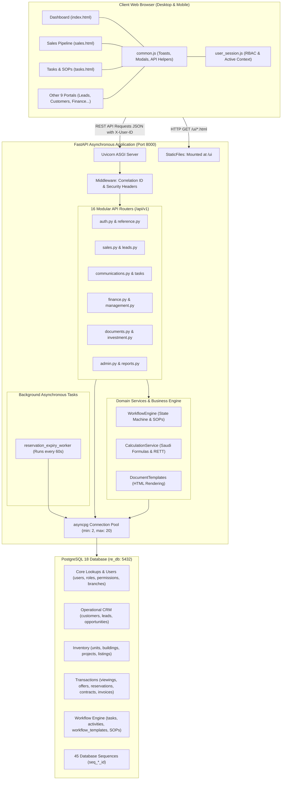
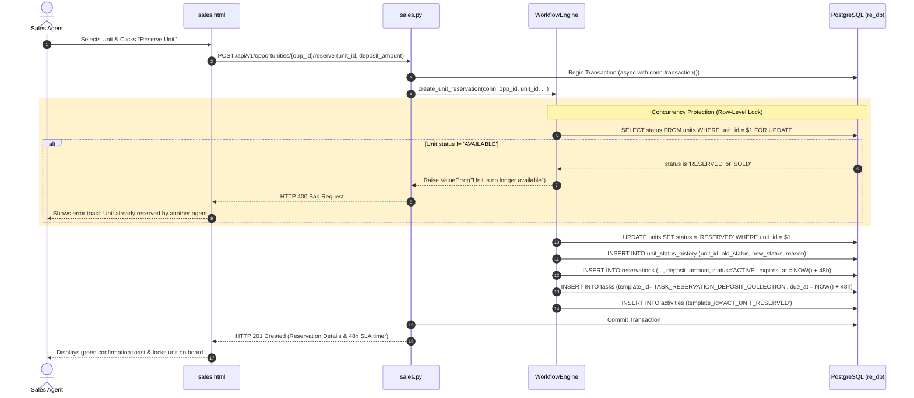
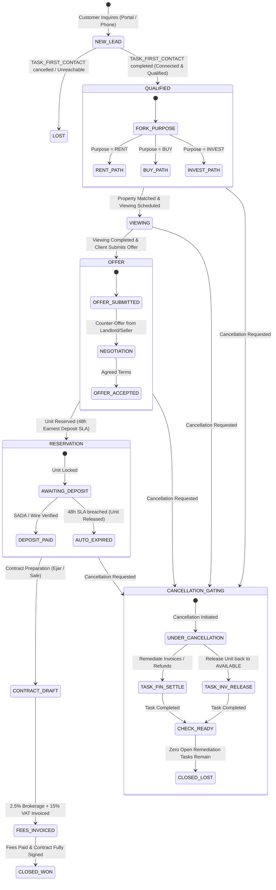
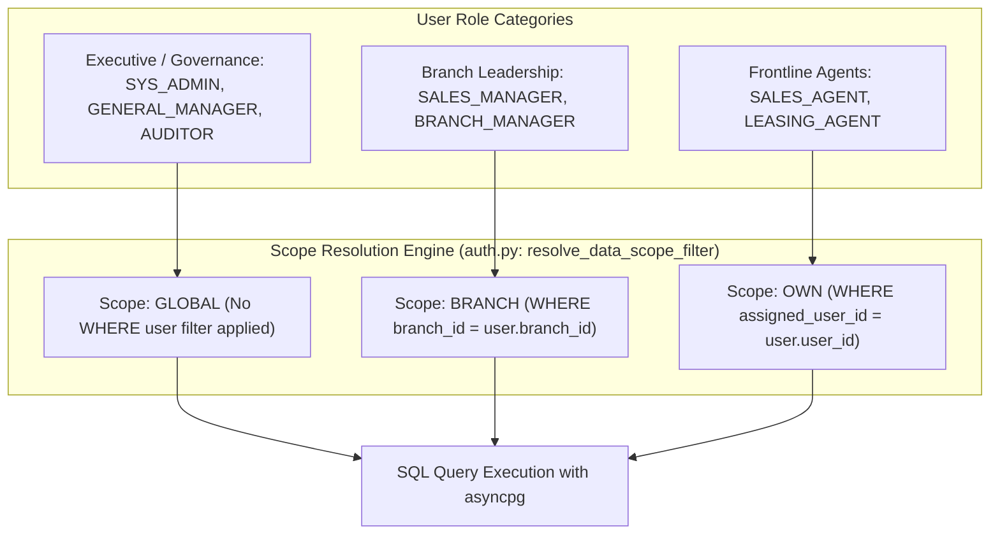

# 03. System Architecture Specification
### توثيق المعمارية العامة للنظام وتدفق العمليات والبيانات

This document provides a detailed architectural specification of the **RECRM** platform, covering its frontend, backend, database layers, communication patterns, state machines, and concurrency controls.

---

## 1. High-Level Architecture Diagram

RECRM is designed as a modular, monolithic asynchronous application. It combines a static multi-portal browser frontend with an asynchronous Python API engine connected directly to a relational PostgreSQL database.



---

## 2. Frontend Architectural Pattern

Unlike single-page application (SPA) frameworks that package the entire application into a massive JavaScript bundle (such as Webpack or Vite), RECRM uses a **Multi-Portal Static Architecture**:
1. **Isolated HTML Portals**: Each business domain has its own dedicated HTML file in [`src/ui/`](file:///home/nemro/RECRM/src/ui) (e.g. `leads.html`, `sales.html`, `tasks.html`, `management.html`).
2. **Shared Foundation Libraries**:
   - [`common.js`](file:///home/nemro/RECRM/src/ui/common.js): Provides unified `apiRequest()` network calls, standard Toast notifications, confirmation modals, number formatting (`formatSAR()`), and date formatters.
   - [`user_session.js`](file:///home/nemro/RECRM/src/ui/user_session.js): Intercepts page loads to enforce Role-Based Access Control (RBAC), manages the active user session in `localStorage`, injects the `X-User-ID` header into all network requests, and renders the user switcher widget.
3. **State Management**:
   - **URL Query Parameters**: High-level context (such as `opportunity_id=opportunity-45` or `search=lead-102`) is mirrored in the browser address bar for shareable deep-linking.
   - **DOM State**: Filter states, tab selections, and modal inputs are stored directly in DOM elements, eliminating complex client-side reactive store synchronization issues.
   - **Local Storage**: Stores user preferences, current language selection (`currentLang: 'ar' | 'en'`), and selected employee identity.

---

## 3. Backend Architectural Pattern

The backend follows a **Layered Asynchronous Architecture**:

```
HTTP Request ➔ Middleware ➔ Router (Controller) ➔ Service Layer ➔ asyncpg Pool ➔ PostgreSQL
```

### Layer 1: Middleware & Lifespan
- **Lifespan Manager** ([`src/backend/app/main.py`](file:///home/nemro/RECRM/src/backend/app/main.py#L38)): Manages application startup and shutdown. On startup, it establishes the asyncpg database connection pool (`init_db_pool()`) and spawns the background reservation expiry worker. On shutdown, it cancels workers and closes all database sockets cleanly.
- **Security & Correlation Middleware** ([`main.py`](file:///home/nemro/RECRM/src/backend/app/main.py#L73)): Injects a unique `X-Request-ID` into every request/response cycle, sets standard security headers (`nosniff`, `SAMEORIGIN`, `strict-origin-when-cross-origin`), and enforces cache-busting headers on UI assets.

### Layer 2: API Routers (Controllers)
- 16 discrete routers in [`src/backend/app/routers/`](file:///home/nemro/RECRM/src/backend/app/routers).
- Each router endpoint uses FastAPI's `Depends(get_db)` to acquire a dedicated connection from the connection pool for the lifetime of that request.
- Handles input parsing via Pydantic schemas, permission verification, and scope filtering (`resolve_data_scope_filter`).

### Layer 3: Domain Services
- **`WorkflowEngine`** ([`src/backend/app/services/workflow_engine.py`](file:///home/nemro/RECRM/src/backend/app/services/workflow_engine.py)): Central state machine that enforces standard operating procedures, chains dependent tasks, handles smart reopen/undo, checks SLAs, and manages gated cancellations.
- **`CalculationService`** ([`src/backend/app/services/calculation_service.py`](file:///home/nemro/RECRM/src/backend/app/services/calculation_service.py)): Implements pure business math: Saudi brokerage commissions (2.5%), VAT (15%), RETT (5%), Net Operating Income (NOI), Cap Rates, and multi-factor property matching scores.
- **`DocumentTemplates`** ([`src/backend/app/services/document_templates.py`](file:///home/nemro/RECRM/src/backend/app/services/document_templates.py)): Formats and renders official Saudi real estate documents into clean, print-ready HTML documents.

### Layer 4: Data Access Layer
- Raw asynchronous SQL queries using **`asyncpg`**.
- Explicit transaction handling via `async with conn.transaction():`.
- Zero ORM impedance mismatch; queries take full advantage of PostgreSQL native features (prepared statements, sequences, JSONB operators, and CTEs).

---

## 4. End-to-End Request Flow: Unit Reservation & Concurrency Lock

The diagram below illustrates how RECRM protects against double-booking when an agent reserves a property unit:



---

## 5. Workflow State Machine Architecture

The lifecycle of any real estate transaction in RECRM is driven by a deterministic state machine governed by `workflow_templates` and `workflow_sop_guidance`.



---

## 6. Gated Deal Cancellation & Remediation Architecture

A key architectural rule enforced by RECRM is that **a deal cannot be marked lost or cancelled while financial or asset commitments remain unresolved**:

1. **Obligation Analysis**:
   - The system checks `invoices` for unpaid/active bills.
   - The system checks `reservations` for active unit holds and deposited money (`عربون`).
   - The system checks `opportunity_units` for units held in `RESERVED` status.
2. **Forking Logic**:
   - If **zero obligations exist**: The deal moves immediately to `CLOSED_LOST` and linked leads move to `LOST`.
   - If **obligations exist**:
     - The opportunity transitions to **`UNDER_CANCELLATION`**.
     - Open operational forward tasks are automatically cancelled.
     - Two mandatory remediation tasks are spawned:
       * `TASK_DEAL_FINANCIAL_SETTLEMENT` (Assigned to Accountant, 48h SLA): Audit invoices, issue credit notes, return deposits.
       * `TASK_DEAL_INVENTORY_RELEASE` (Assigned to Sales Agent, 12h SLA): Release unit hold back to `AVAILABLE`.
     - Direct `PATCH` requests to `CLOSED_LOST` are blocked with `HTTP 400`.
3. **Automated Finalization**:
   - When each remediation task is completed via `complete_task_with_outcome`, the engine verifies whether any open remediation tasks remain.
   - When the count reaches zero, the system automatically finalizes the deal to `CLOSED_LOST` and updates the linked lead to `LOST`.

---

## 7. Data Scoping & Authorization Architecture

Data visibility in RECRM follows a hierarchical scoping model resolved dynamically on every query:



- **Frontline Agent Isolation**: When an agent with `OWN` scope calls `/api/v1/leads` or `/api/v1/tasks`, `resolve_data_scope_filter` forces the query parameter to their own `user_id`. Even if the agent maliciously tampers with the query string (e.g. `?assigned_user_id=user-99`), the backend strictly overrides it and restricts rows to their own assignments.
- **Branch Manager Visibility**: A manager in Jeddah automatically sees all leads, opportunities, and viewings belonging to agents in the Jeddah branch, but cannot see records belonging to the Riyadh or Medina branches unless granted global executive privileges.

