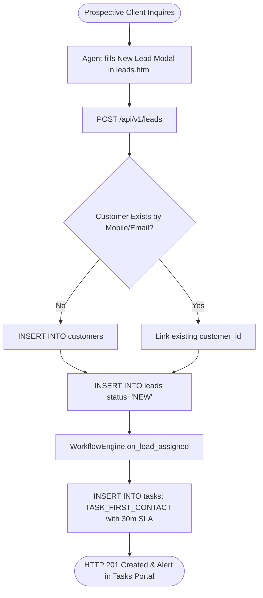
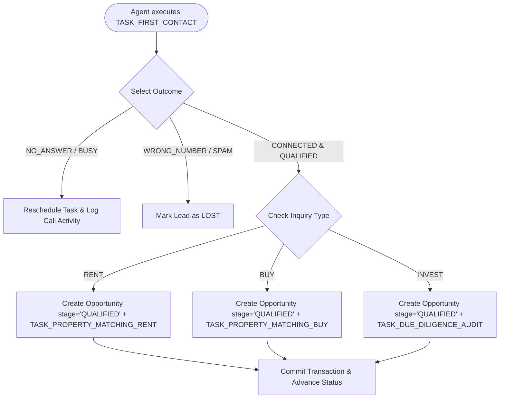
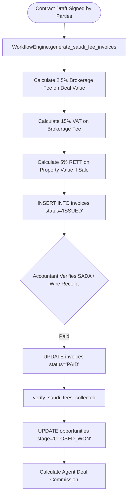

# 06. Business Workflows Specification
### الدليل الإجرائي لمسارات العمليات العقارية ونقاط القرار

This document details the primary business workflows verified in the **RECRM** codebase, mapping user actions to backend services, database transactions, statutory rules, and audit events.

---

## Workflow 1: Lead Intake, Deduplication & Initial Contact Assignment



- **Starting Condition**: A prospective client reaches out via portal advertisement, phone call, or walk-in.
- **User Action**: The agent or receptionist navigates to [`src/ui/leads.html`](file:///home/nemro/RECRM/src/ui/leads.html) and clicks **"+ New Lead"**.
- **Required Input**: Customer Full Name, Mobile Number (`+9665...`), Purpose (`RENT`, `BUY`, `INVEST`), Property Type, City, Budget Range (`budget_min`, `budget_max`).
- **Validation**:
  - `budget_min <= budget_max`.
  - Phone normalized to E.164 Saudi format via `normalize_saudi_phone`.
- **Permission Checks**: User must possess `LEAD_WRITE` permission.
- **Backend Processing** ([`src/backend/app/routers/leads.py: create_lead`](file:///home/nemro/RECRM/src/backend/app/routers/leads.py)):
  1. Calls [`WorkflowEngine.find_or_create_customer`](file:///home/nemro/RECRM/src/backend/app/services/workflow_engine.py#L141) to prevent duplicate profiles.
  2. Generates sequential IDs (`customer-X`, `lead-Y`) using PostgreSQL sequences.
  3. Triggers `WorkflowEngine.on_lead_assigned()`, generating a high-priority `TASK_FIRST_CONTACT` task with an exact 30-minute SLA deadline (`NOW() + 30 minutes`).
- **Database Changes**:
  - `INSERT INTO customers` (if new).
  - `INSERT INTO leads (lead_id, customer_id, inquiry_type, status='NEW', ...)`.
  - `INSERT INTO tasks (template_id='TASK_FIRST_CONTACT', due_at=NOW()+30m, status='OPEN')`.
  - `INSERT INTO activities (template_id='ACT_LEAD_ASSIGNED')`.
- **Response**: `ResponseEnvelope[LeadOut]` with HTTP 201 status code.
- **Final User-Visible Result**: Lead appears in the Leads table; an urgent task badge appears on the agent's dashboard with an active 30-minute countdown.
- **Failure Cases**: Invalid phone number format returns HTTP 422; database connectivity timeout returns HTTP 500.

---

## Workflow 2: Purpose-Based Qualification & Opportunity Forking



- **Starting Condition**: A lead is in status `NEW` with an open `TASK_FIRST_CONTACT`.
- **User Action**: The agent calls the client, opens [`src/ui/tasks.html`](file:///home/nemro/RECRM/src/ui/tasks.html), and clicks **"✓ إنجاز وتسجيل النتيجة"** (Complete Task).
- **Required Input**: Outcome (`CONNECTED`), Notes, Verified Budget, Preferred City, and Checkbox: "Qualify Lead".
- **Business Rules**:
  - Creating a lead does *not* qualify it. Only explicit contact verification advances status.
  - The inquiry purpose dictates the opportunity lifecycle:
    * `RENT` forks into tenant vetting and viewing.
    * `BUY` forks into purchase financing and property matching.
    * `INVEST` forks into technical due diligence, CapEx inspection, and yield modeling.
- **Backend Processing** ([`src/backend/app/routers/communications.py: complete_task`](file:///home/nemro/RECRM/src/backend/app/routers/communications.py)):
  1. Invokes [`WorkflowEngine.complete_task_with_outcome`](file:///home/nemro/RECRM/src/backend/app/services/workflow_engine.py#L4009).
  2. Dispatches to `WorkflowEngine.on_lead_qualified()`.
  3. Inserts an `opportunities` row linked to the `lead_id` and `customer_id`.
  4. Spawns the purpose-specific matching task.
- **Database Changes**:
  - `UPDATE tasks SET status='COMPLETED', completed_at=NOW() WHERE task_id=$1`.
  - `UPDATE leads SET status='QUALIFIED' WHERE lead_id=$1`.
  - `INSERT INTO opportunities (opportunity_id, customer_id, lead_id, stage='QUALIFIED', ...)`.
  - `INSERT INTO activities (template_id='ACT_LEAD_QUALIFIED')`.
- **Final User-Visible Result**: The task moves to the completed archive; the lead status turns green (`QUALIFIED`); a new opportunity card appears in the Sales Pipeline board ([`src/ui/sales.html`](file:///home/nemro/RECRM/src/ui/sales.html)).

---

## Workflow 3: Property Matching & Viewing Appointment Scheduling

```mermaid
flowchart TD
    MatchStart([Opportunity in QUALIFIED stage]) --> OpenMatching[Agent opens Matched Units Drawer]
    OpenMatching --> Engine[CalculationService.calculate_property_match_score]
    Engine --> FilterAvail[Exclude Non-Available & Over-Budget Units]
    FilterAvail --> DisplayList[Display Candidate Units ranked by Score %]
    DisplayList --> SelectUnit[Agent selects Unit & schedules tour]
    SelectUnit --> PostViewing[POST /api/v1/opportunities/{id}/viewings]
    PostViewing --> InsertViewing[INSERT INTO viewings status='SCHEDULED']
    InsertViewing --> AdvanceOpp[UPDATE opportunities stage='VIEWING']
    AdvanceOpp --> SpawnViewingTask[INSERT INTO tasks: TASK_CONDUCT_PROPERTY_VIEWING]
```

- **Starting Condition**: Opportunity is in stage `QUALIFIED`.
- **User Action**: The agent reviews matched units, selects a candidate property, and schedules a viewing with the customer.
- **Required Input**: `unit_id`, `scheduled_start`, `scheduled_end`, `location_notes`.
- **Validation**:
  - Unit status must be `AVAILABLE`.
  - `scheduled_start` must be in the future.
  - `scheduled_end > scheduled_start`.
- **Backend Processing** ([`src/backend/app/routers/sales.py`](file:///home/nemro/RECRM/src/backend/app/routers/sales.py)):
  1. Invokes [`WorkflowEngine.schedule_property_viewing`](file:///home/nemro/RECRM/src/backend/app/services/workflow_engine.py#L1111).
  2. Creates viewing record in `viewings`.
  3. Advances opportunity stage from `QUALIFIED` to `VIEWING`.
  4. Spawns `TASK_CONDUCT_PROPERTY_VIEWING` with the viewing time.
- **Database Changes**:
  - `INSERT INTO viewings (viewing_id, opportunity_id, unit_id, scheduled_start, ...)`.
  - `UPDATE opportunities SET stage='VIEWING' WHERE opportunity_id=$1`.
  - `INSERT INTO tasks (template_id='TASK_CONDUCT_PROPERTY_VIEWING')`.
  - `INSERT INTO activities (template_id='ACT_VIEWING_SCHEDULED')`.
- **Failure Cases**: Attempting to schedule a tour on a `SOLD` or `RENTED` unit throws HTTP 400.

---

## Workflow 4: Unit Reservation, 48h Earnest Deposit & Concurrency Locking

```mermaid
flowchart TD
    ReserveStart([Customer makes decision to reserve]) --> OpenModal[Agent clicks Reserve Unit in sales.html]
    OpenModal --> EnterDeposit[Enter Deposit Amount e.g. 25,000 SAR]
    EnterDeposit --> PostReserve[POST /api/v1/opportunities/{id}/reserve]
    
    subgraph AtomicLock ["Atomic Concurrency Transaction"]
        PostReserve --> RowLock[SELECT status FROM units WHERE unit_id=$1 FOR UPDATE]
        RowLock --> CheckStatus{status == 'AVAILABLE'?}
        CheckStatus -- No --> Abort[ROLLBACK & Raise HTTP 400 'Unit Locked']
        CheckStatus -- Yes --> LockUnit[UPDATE units SET status='RESERVED']
        LockUnit --> InsertHist[INSERT INTO unit_status_history]
        InsertHist --> InsertRes[INSERT INTO reservations expires_at=NOW()+48h]
        InsertRes --> CreateTask[INSERT INTO tasks: TASK_RESERVATION_DEPOSIT_COLLECTION]
    end
    
    CreateTask --> Success([HTTP 201 Created & 48h Countdown Starts])
```

- **Starting Condition**: Client chooses a specific unit after viewing and agrees on commercial terms.
- **User Action**: The agent clicks **"حجز الوحدة"** (Reserve Unit) in [`src/ui/sales.html`](file:///home/nemro/RECRM/src/ui/sales.html).
- **Required Input**: `unit_id`, `deposit_amount` (e.g. 25,000 SAR), `expires_in_hours` (default: 48).
- **Concurrency Protection**:
  - Employs **`SELECT ... FOR UPDATE`** row-level locking on the target row in `units`.
  - If another agent submitted a reservation request a millisecond earlier, the second transaction is immediately blocked and rolls back safely.
- **Backend Processing** ([`src/backend/app/routers/sales.py: reserve_opportunity_unit`](file:///home/nemro/RECRM/src/backend/app/routers/sales.py)):
  1. Invokes [`WorkflowEngine.create_unit_reservation`](file:///home/nemro/RECRM/src/backend/app/services/workflow_engine.py#L2417).
  2. Sets `units.status = 'RESERVED'`.
  3. Records entry in `reservations` with `expires_at = NOW() + INTERVAL '48 hours'`.
  4. Creates `TASK_RESERVATION_DEPOSIT_COLLECTION` assigned to the accountant and sales agent.
- **Background SLA Monitoring**:
  - The worker `reservation_expiry_worker` in [`src/backend/app/main.py`](file:///home/nemro/RECRM/src/backend/app/main.py#L20) runs every 60 seconds.
  - If `NOW() > expires_at` and deposit remains unpaid, the worker automatically cancels the reservation, returns `units.status = 'AVAILABLE'`, logs an expiry audit note, and notifies the branch manager.

---

## Workflow 5: Saudi Statutory Fee Invoicing & Deal Closing



- **Starting Condition**: Purchase or tenancy contract signed.
- **Business Rules**:
  - Real estate brokerage fee is capped at 2.5% per REGA regulations.
  - VAT (15%) applies to the brokerage service fee.
  - Real Estate Transaction Tax (RETT / 5%) applies to purchase transactions.
  - **Gating Rule**: An opportunity *cannot* be marked `CLOSED_WON` until the statutory brokerage invoices are fully paid and verified.
- **Backend Processing**:
  1. [`WorkflowEngine.generate_saudi_fee_invoices`](file:///home/nemro/RECRM/src/backend/app/services/workflow_engine.py#L3331) generates official ZATCA-formatted invoices.
  2. The accountant records the payment voucher via `POST /api/v1/finance/payments`.
  3. When attempting `PATCH /api/v1/opportunities/{id}` with `stage='WON'`, [`WorkflowEngine.verify_saudi_fees_collected`](file:///home/nemro/RECRM/src/backend/app/services/workflow_engine.py#L3888) queries the database to confirm zero balance due.
- **Database Changes**:
  - `INSERT INTO invoices (invoice_number, subtotal, vat_rate=15, vat_amount, total_amount, status='ISSUED')`.
  - `INSERT INTO payments (payment_number, amount, payment_method, status='CONFIRMED')`.
  - `UPDATE opportunities SET stage='CLOSED_WON'`.
  - `UPDATE units SET status='SOLD'` or `'RENTED'`.

---

## Workflow 6: Gated Deal Cancellation & Remediation Engine

```mermaid
flowchart TD
    CancelReq([User clicks Cancel Deal in sales.html]) --> WarnModal[Warning Modal modal-cancel-opportunity appears]
    WarnModal --> Confirm[User selects Loss Reason & confirms cancellation]
    Confirm --> PostCancel[POST /api/v1/opportunities/{id}/cancel]
    
    PostCancel --> InspectCommitments{Check Financial & Inventory Liabilities}
    InspectCommitments -- Zero Commitments --> DirectLost[UPDATE opportunities stage='CLOSED_LOST']
    
    InspectCommitments -- Has Invoices / Held Units --> GateDeal[UPDATE opportunities stage='UNDER_CANCELLATION']
    GateDeal --> CancelForwardTasks[Cancel standard open forward operational tasks]
    GateDeal --> SpawnRemediation[Spawn Remediation Tasks]
    
    SpawnRemediation --> TaskFin[TASK_DEAL_FINANCIAL_SETTLEMENT to Accountant]
    SpawnRemediation --> TaskInv[TASK_DEAL_INVENTORY_RELEASE to Sales Agent]
    
    TaskInv --> CompInv[Agent completes Task -> Unit released to AVAILABLE]
    TaskFin --> CompFin[Accountant completes Task -> Invoices & Commissions cancelled]
    
    CompInv --> CheckDone{All Remediation Tasks Completed?}
    CompFin --> CheckDone
    CheckDone -- Yes --> AutoClose[Auto-Finalize opportunity to CLOSED_LOST & lead to LOST]
    CheckDone -- No --> KeepGated[Deal remains in UNDER_CANCELLATION]
```

- **Starting Condition**: A deal in any active stage (`QUALIFIED`, `VIEWING`, `OFFER`, `RESERVATION`) needs to be cancelled due to client withdrawal, financing rejection, or unavailable units.
- **User Action**: The user clicks the red `❌` button in [`src/ui/sales.html`](file:///home/nemro/RECRM/src/ui/sales.html).
- **Mandatory Confirmation Warning**:
  - The modal `#modal-cancel-opportunity` warns the user that cancellations are governed by REGA and the Saudi Civil Transactions Code.
  - Reason selection is mandatory (`PROPERTY_UNAVAILABLE`, `CLIENT_WITHDREW`, `FINANCE`, `PRICE`, `COMPETITOR`, `NO_RESPONSE`, `OTHER`).
- **Gating Logic** ([`WorkflowEngine.initiate_deal_cancellation`](file:///home/nemro/RECRM/src/backend/app/services/workflow_engine.py#L7093)):
  - Checks if the deal has unpaid invoices, deposit receipts, active reservations, or units locked in `RESERVED` status.
  - If liabilities exist, the deal moves to `UNDER_CANCELLATION` and spawns remediation tasks.
  - Any direct attempt to PATCH stage to `LOST` is blocked with HTTP 400.
- **Automated Finalization** ([`WorkflowEngine.check_and_finalize_cancellation_if_ready`](file:///home/nemro/RECRM/src/backend/app/services/workflow_engine.py#L7308)):
  - Once the accountant settles the financials and the agent releases the inventory, the system automatically marks the deal `CLOSED_LOST` and linked lead `LOST`, logging `ACT_DEAL_CANCELLATION_FINALIZED`.

---

## Workflow 7: Smart Task Reopen & Downstream Rollback

```mermaid
flowchart TD
    DoneTask([Completed Task in tasks.html]) --> ClickUndo[User clicks ↩️ Undo / Reopen]
    ClickUndo --> PostReopen[POST /api/v1/tasks/{id}/reopen]
    PostReopen --> CheckDownstream[WorkflowEngine.reopen_task checks downstream records]
    CheckDownstream --> RevertTask[UPDATE tasks SET status='PENDING', completed_at=NULL]
    CheckDownstream --> RollbackViewings[Cancel unexecuted viewings spawned by this task]
    CheckDownstream --> CancelChildTasks[Cancel untouched child tasks spawned by this task]
    CheckDownstream --> RevertStage[Revert opportunity stage to prior valid stage]
    RevertStage --> LogActivity[INSERT INTO activities: ACT_TASK_REOPENED]
    LogActivity --> SuccessToast([Task reopened & downstream jobs cleanly rolled back])
```

- **Starting Condition**: A task was completed mistakenly by an employee (e.g. marked "Qualified" by accident).
- **User Action**: The agent clicks **"↩️ تراجع / إعادة فتح"** on the task row in [`src/ui/tasks.html`](file:///home/nemro/RECRM/src/ui/tasks.html).
- **Backend Processing** ([`WorkflowEngine.reopen_task`](file:///home/nemro/RECRM/src/backend/app/services/workflow_engine.py#L6761)):
  1. Verifies that downstream child tasks have not yet been completed by other departments. If an accountant already billed the deal, reopening is blocked with an explanatory error.
  2. Safely cancels any untouched child tasks and scheduled viewings created by the erroneous completion.
  3. Reverts the task status back to `PENDING` with `completed_at = NULL`.
  4. Reverts the opportunity or lead stage back to the preceding stage.
  5. Records `ACT_TASK_REOPENED` in the audit timeline.
- **Final Result**: The system state is restored to its exact condition prior to the accidental click, maintaining audit integrity.

