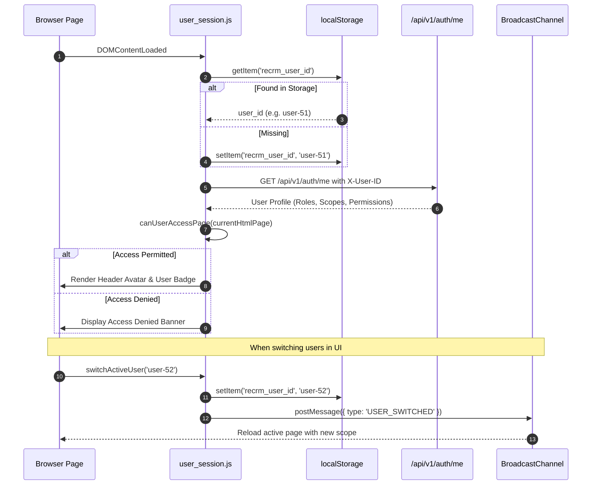

# Frontend Developer Guide

> **Audience**: Beginner to intermediate frontend developers, full-stack engineers, and technical maintainers.  
> **Scope**: Architecture, component patterns, script utilities, styling system, and maintenance workflows for the RECRM client-side interface.

---

## 1. Architectural Philosophy & Overview

The RECRM frontend was intentionally engineered without complex build chains, Node.js packages, transpilers, or heavy frameworks (such as React, Vue, or Angular). 

### Why Vanilla JavaScript & Native HTML5/CSS3?
1. **Zero Build Dependency**: No `npm install`, no `webpack`, no `vite`, and no broken dependency trees. Every file can be edited directly and immediately refreshed in the browser.
2. **Instant Debugging**: The source code running in the browser DevTools is the exact file on disk. Stack traces point directly to real lines in `.js` or `.html` files.
3. **High Performance**: Native browser execution without virtual DOM diffing overhead or heavy bundle downloads. Pages load in milliseconds over local network connections.
4. **Native RTL Support**: Standard CSS `dir="rtl"` with modern CSS variables, flexbox, and grid layouts provides native Arabic typography without CSS-in-JS complexities.

```
src/ui/
├── index.html                  # Executive Dashboard & Global Task Center
├── customer_360.html           # Unified Customer Profile & Financial Summary
├── leads.html                  # Lead Intake, Discovery & Qualification
├── inventory.html              # Property & Unit Directory, Unit Matcher
├── opportunities.html          # Sales Pipeline & Deal Negotiation Workbench
├── invoices.html               # ZATCA-compliant Invoices & Commission Ledger
├── property_management.html    # Leases, Facilities & Inspection Records
├── maintenance.html            # Maintenance Requests & Work Orders
├── owners.html                 # Property Owners & Yield Distribution Engine
├── campaigns.html              # Marketing Campaigns & Multi-Channel ROI
├── sop_tasks.html              # Step-by-Step Task Workbench & SOP Runner
├── system_settings.html        # RBAC Roles, Scope Control & System Config
├── common.js                   # Unified API client, toasts, formatters & modals
└── user_session.js             # Active user switcher, RBAC gatekeeper & session sync
```

---

## 2. Hosting & Serving Architecture

The frontend is served directly by the FastAPI backend using Starlette's `StaticFiles` handler:

```python
# In src/backend/app/main.py (lines 142-145)
app.mount("/ui", StaticFiles(directory="src/ui", html=True), name="ui")

@app.get("/")
def root():
    return RedirectResponse(url="/ui/index.html")
```

- **Root Access**: Visiting `http://localhost:8000/` automatically redirects to `http://localhost:8000/ui/index.html`.
- **Static Assets**: Any file placed in `src/ui/` is accessible under the `/ui/` URL prefix (e.g., `http://localhost:8000/ui/common.js`).
- **No CORS Issues**: Because frontend pages and API endpoints share the same host and port (`localhost:8000`), requests are same-origin by default.

---

## 3. The 12 Operational Portals

| # | Portal File | Arabic Title | Primary Target Roles | Core Capabilities |
|---|---|---|---|---|
| 1 | [`index.html`](file:///home/nemro/RECRM/src/ui/index.html) | لوحة المؤشرات والتقارير | All Roles (Scoped) | KPI summary cards, personal task inbox, high-priority alerts, team workload chart. |
| 2 | [`customer_360.html`](file:///home/nemro/RECRM/src/ui/customer_360.html) | العملاء 360 | Sales, Finance, Managers | Complete customer timeline, National ID/CR, AML status, active deals, contracts, ledger. |
| 3 | [`leads.html`](file:///home/nemro/RECRM/src/ui/leads.html) | الطلبات الواردة والتأهيل | Sales Agents, Marketing | Lead intake form, qualification forking (Residential vs Commercial vs Investment), lead assigner. |
| 4 | [`inventory.html`](file:///home/nemro/RECRM/src/ui/inventory.html) | المخزون والوحدات العقارية | Sales, Property Managers | Properties & units grid, availability statuses, 48-hour reservation modal, unit matcher. |
| 5 | [`opportunities.html`](file:///home/nemro/RECRM/src/ui/opportunities.html) | الصفقات ومسار المبيعات | Sales Agents, Directors | Kanban/Table pipeline (RESERVATION → CONTRACT → CLOSING), financial terms, gated cancellation. |
| 6 | [`invoices.html`](file:///home/nemro/RECRM/src/ui/invoices.html) | المالية والفوترة والضريبة | Accountants, Auditors | ZATCA tax invoice generation, 2.5% brokerage fee, 15% VAT, 5% RETT calculation, payment receipts. |
| 7 | [`property_management.html`](file:///home/nemro/RECRM/src/ui/property_management.html) | إدارة الأملاك والتأجير | Property Managers | Ejar contract tracking, rent collection schedules, unit occupancy tracking, condition inspection logs. |
| 8 | [`maintenance.html`](file:///home/nemro/RECRM/src/ui/maintenance.html) | الصيانة والتشغيل | Facility Officers | Work order tickets, contractor dispatching, cost approvals, status tracking (OPEN → IN_PROGRESS → RESOLVED). |
| 9 | [`owners.html`](file:///home/nemro/RECRM/src/ui/owners.html) | علاقات الملاك والتوزيعات | Asset Managers, Finance | Owner registry, net operating income (NOI), management fee deductions, periodic payout statements. |
| 10 | [`campaigns.html`](file:///home/nemro/RECRM/src/ui/campaigns.html) | التسويق والحملات الإعلانية | Marketing Managers | Advertising campaigns (Meta, Google, Snapchat, SMS), budget tracking, lead conversion attribution. |
| 11 | [`sop_tasks.html`](file:///home/nemro/RECRM/src/ui/sop_tasks.html) | إنجاز المهام وإجراءات العمل | All Operational Staff | Dynamic SOP checklist execution, document uploads, financial verification, decision audit logging. |
| 12 | [`system_settings.html`](file:///home/nemro/RECRM/src/ui/system_settings.html) | إعدادات النظام والصلاحيات | System Administrators | User account management, role & permission assignments, branch configuration, audit log viewer. |

---

## 4. Shared Core Libraries

The RECRM frontend relies on two lightweight JavaScript files included in every page:

### 4.1. `common.js` (Unified Application Utilities)
Located at [`src/ui/common.js`](file:///home/nemro/RECRM/src/ui/common.js), this script provides:

#### 1. Toast Notification System (`showToast`)
Provides non-blocking visual feedback for API responses, errors, and system events.
```javascript
// Function signature
showToast(message, type = 'info', duration = 3500)

// Examples
showToast('تم حفظ التعديلات بنجاح', 'success');
showToast('حدث خطأ أثناء تحميل البيانات', 'error');
showToast('يرجى التحقق من المدخلات', 'warning');
```
- **Auto-detection**: If `type` is omitted, `showToast` inspects the message text (e.g., words like `نجاح` or `success` auto-switch to `'success'`; `خطأ` or `error` switch to `'error'`).
- **Container**: Appends to a fixed `#recrm-toast-container` floating at the bottom right.

#### 2. Centralized API Client (`apiRequest`)
A wrapper around standard `window.fetch()` that automatically attaches the user session header:
```javascript
async function apiRequest(endpoint, options = {}) {
    const defaultHeaders = {
        'Content-Type': 'application/json',
        'X-User-ID': localStorage.getItem('recrm_user_id') || 'user-51'
    };
    
    const response = await fetch(endpoint, {
        ...options,
        headers: { ...defaultHeaders, ...(options.headers || {}) }
    });
    
    if (!response.ok) {
        const errorData = await response.json().catch(() => ({}));
        throw new Error(errorData.detail?.message || `HTTP ${response.status}`);
    }
    return await response.json();
}
```

#### 3. Formatting Helpers
- `formatCurrency(amount)`: Formats numbers into Saudi Riyal notation (e.g., `1,250,000.00 ر.س`).
- `formatDate(isoString)`: Converts ISO 8601 strings into localized Gregorian dates (e.g., `2026-10-31`).
- `copyId(elementId)`: Copies text to the system clipboard with an instant confirmation toast.

---

### 4.2. `user_session.js` (RBAC & User Switcher)
Located at [`src/ui/user_session.js`](file:///home/nemro/RECRM/src/ui/user_session.js), this script handles client-side security and development switching:



#### Key Capabilities of `user_session.js`:
1. **Interactive User Switcher Modal**: Clickable via the top navigation bar to simulate any of the 10 seeded users (System Admin, Broker, Accountant, Viewer, etc.) without logging out.
2. **Page Access Authorization Map (`PAGE_ACCESS_MAP`)**: Checks whether the active user's roles match the required roles for the current HTML page.
3. **Cross-Tab Synchronization (`BroadcastChannel`)**: Switching users in one browser tab automatically triggers a synchronized reload in all other open RECRM tabs via a `BroadcastChannel` named `recrm_session_sync`.

---

## 5. Styling System & RTL Architecture

RECRM uses a custom, responsive CSS design system optimized for Arabic right-to-left layout:

### 5.1. CSS Design Tokens
Each HTML file defines or imports consistent root variables:

```css
:root {
    /* Primary Color Palette */
    --primary-color: #0d9488;         /* Teal / Emerald - Primary Brand */
    --primary-hover: #0f766e;
    --primary-light: #f0fdfa;
    
    /* Background & Surface Colors */
    --bg-page: #f8fafc;              /* Slate-50 - Page Canvas */
    --bg-card: #ffffff;              /* Card Background */
    --border-color: #e2e8f0;         /* Slate-200 - Borders */
    
    /* Text Hierarchy */
    --text-primary: #0f172a;         /* Slate-900 - Headings & Body */
    --text-secondary: #475569;       /* Slate-600 - Metadata */
    --text-muted: #94a3b8;           /* Slate-400 - Placeholders */
    
    /* Status Colors */
    --status-success: #10b981;       /* Emerald - Active, Completed */
    --status-warning: #f59e0b;       /* Amber - Pending, In Progress */
    --status-danger: #ef4444;        /* Rose - Cancelled, Rejected */
    --status-info: #3b82f6;          /* Blue - Processing, In Review */
    
    /* Layout Tokens */
    --radius-sm: 6px;
    --radius-md: 10px;
    --radius-lg: 16px;
    --shadow-card: 0 1px 3px rgba(0,0,0,0.06), 0 1px 2px rgba(0,0,0,0.04);
}
```

### 5.2. Typography & Font Stack
The application uses modern Arabic web typography imported via Google Fonts:
```html
<link rel="preconnect" href="https://fonts.googleapis.com">
<link rel="preconnect" href="https://fonts.gstatic.com" crossorigin>
<link href="https://fonts.googleapis.com/css2?family=Cairo:wght@400;600;700&family=Tajawal:wght@400;500;700&display=swap" rel="stylesheet">
```
- **Heading Font**: `Cairo` (bold, readable geometric Arabic font).
- **Body Font**: `Tajawal` or `Almarai` (clean legible Arabic font suited for high-density tables).
- **RTL Direction**: Declared on the root `<html>` tag: `<html lang="ar" dir="rtl">`.

---

## 6. Communication Pattern with Backend

All frontend pages interact with the backend exclusively via JSON over HTTP REST.

### 6.1. Standard Request Pattern
```javascript
async function loadLeadDetails(leadId) {
    try {
        const response = await fetch(`/api/v1/leads/${leadId}`, {
            headers: {
                'Content-Type': 'application/json',
                'X-User-ID': localStorage.getItem('recrm_user_id') || 'user-51'
            }
        });

        if (!response.ok) {
            const error = await response.json();
            throw new Error(error.detail?.message || 'Failed to load lead');
        }

        const data = await response.json();
        renderLeadDetails(data);
    } catch (err) {
        console.error('Fetch error:', err);
        showToast(err.message, 'error');
    }
}
```

---

## 7. Beginner Developer Tutorials

### Tutorial 1: Adding a New Form Field and Sending It to the Backend

**Goal**: Add a "National ID" field to the lead creation form and include it in the POST request.

#### Step 1: Add HTML input in `leads.html`
```html
<!-- Inside the Lead Modal Form -->
<div class="form-group">
    <label for="lead-national-id" class="form-label">رقم الهوية الوطنية / الإقامة</label>
    <input type="text" id="lead-national-id" class="form-control" 
           placeholder="10XXXXXXXX" maxlength="10" pattern="[12][0-9]{9}">
</div>
```

#### Step 2: Extract and include in JavaScript submit handler
```javascript
async function handleCreateLead(event) {
    event.preventDefault();
    
    // Read the new input value
    const nationalId = document.getElementById('lead-national-id').value.trim();

    const payload = {
        first_name: document.getElementById('lead-first-name').value.trim(),
        last_name: document.getElementById('lead-last-name').value.trim(),
        phone: document.getElementById('lead-phone').value.trim(),
        national_id: nationalId || null,  // Send null if empty
        service_type: 'PURCHASE',
        property_type: 'APARTMENT'
    };

    try {
        const result = await apiRequest('/api/v1/leads/', {
            method: 'POST',
            body: JSON.stringify(payload)
        });
        showToast('تم تسجيل الطلب بنجاح', 'success');
        closeModal();
        reloadLeadsTable();
    } catch (err) {
        showToast(`فشل الحفظ: ${err.message}`, 'error');
    }
}
```

---

### Tutorial 2: Creating a Confirmation Modal

**Goal**: Ask for confirmation before cancelling a reservation.

```javascript
function confirmCancelReservation(reservationId) {
    // 1. Create backdrop overlay
    const modal = document.createElement('div');
    modal.className = 'recrm-modal-backdrop';
    modal.innerHTML = `
        <div class="recrm-modal-dialog">
            <h3 class="modal-title">تأكيد إلغاء الحجز</h3>
            <p>هل أنت متأكد من رغبتك في إلغاء الحجز رقم <strong>${reservationId}</strong>؟ سيتم إعادة الوحدة إلى المخزون المتاح.</p>
            <div class="modal-actions">
                <button id="confirm-btn" class="btn btn-danger">نعم، تأكيد الإلغاء</button>
                <button id="cancel-btn" class="btn btn-secondary">تراجع</button>
            </div>
        </div>
    `;

    document.body.appendChild(modal);

    // 2. Wire event listeners
    modal.querySelector('#cancel-btn').addEventListener('click', () => {
        modal.remove();
    });

    modal.querySelector('#confirm-btn').addEventListener('click', async () => {
        try {
            await apiRequest(`/api/v1/reservations/${reservationId}/cancel`, {
                method: 'POST',
                body: JSON.stringify({ reason: 'Client requested cancellation' })
            });
            showToast('تم إلغاء الحجز بنجاح', 'success');
            modal.remove();
            reloadPageData();
        } catch (err) {
            showToast(err.message, 'error');
        }
    });
}
```

---

## 8. Summary Checklist for Frontend Changes

Before submitting or testing frontend changes:
- [ ] Ensure Arabic text is written in proper Right-to-Left context.
- [ ] Always check that `X-User-ID` is included in custom `fetch` headers (or use `apiRequest()`).
- [ ] Use `showToast()` to deliver feedback instead of `alert()`.
- [ ] Test the page under multiple user roles using the `user_session.js` user switcher.
- [ ] Verify responsive rendering on desktop (1920x1080) and tablet viewports (768px+).

