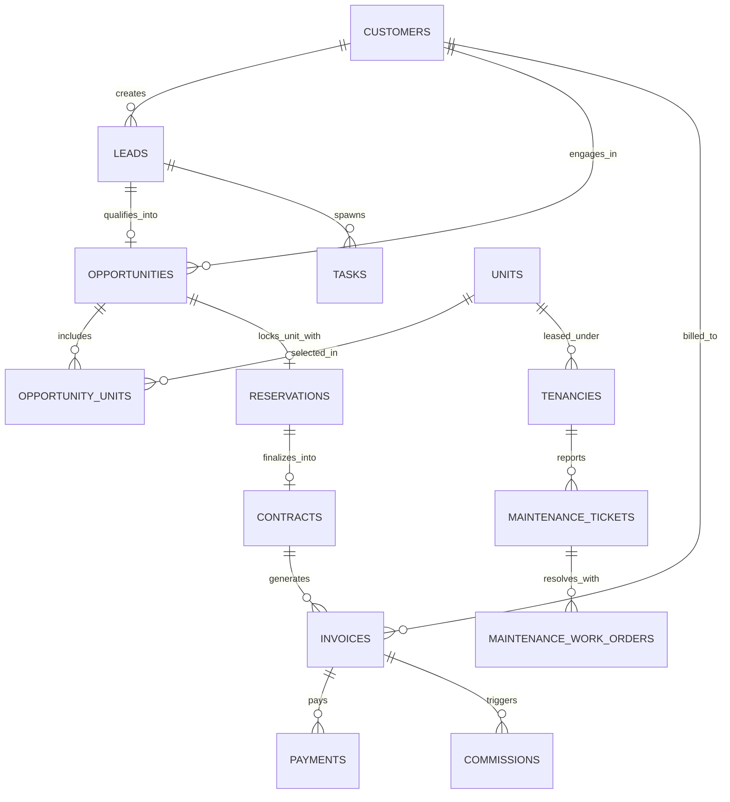

# Database Developer Guide

> **Audience**: Database administrators, backend engineers, and data engineers.  
> **Scope**: Schema architecture, 54 relational tables, 45 sequences, primary key conventions, concurrency control, and transactional maintenance scripts in PostgreSQL.

---

## 1. Database Architecture & Engine Overview

RECRM uses **PostgreSQL 16+** as its primary relational store.

```
+-----------------------------------------------------------------------------------------+
|                                PostgreSQL Engine (re_db)                                |
|                                                                                         |
|   +-----------------------+    +-----------------------+    +-----------------------+   |
|   | 54 Base Tables        |    | 45 Primary Sequences  |    | Constraints & Indexes |   |
|   | - Pure Relational     |    | - seq_{table}_id      |    | - Foreign Keys (FK)   |   |
|   | - Normalized (3NF)    |    | - Human-readable IDs  |    | - CHECK Constraints   |   |
|   | - Native JSON/JSONB   |    |   e.g. cust-101       |    | - Composite Indexes   |   |
|   +-----------------------+    +-----------------------+    +-----------------------+   |
|                                                                                         |
|   +---------------------------------------------------------------------------------+   |
|   | Concurrency Control:                                                            |   |
|   | - SELECT ... FOR UPDATE (Row-level exclusive locks)                             |   |
|   | - READ COMMITTED Transaction Isolation Level                                    |   |
|   | - Atomic Multi-table Transactions (async with conn.transaction())               |   |
|   +---------------------------------------------------------------------------------+   |
+-----------------------------------------------------------------------------------------+
```

### Connection Configuration (`.env`)
```ini
DB_HOST=localhost
DB_PORT=5432
DB_USER=postgres
DB_PASSWORD=********
DB_NAME=re_db
```

---

## 2. Complete Catalog of the 54 Tables

The 54 tables in `re_db` are organized into 9 functional domains:

### Domain 1: System, Authentication & Organization (7 Tables)
| Table Name | Primary Key | Description |
|---|---|---|
| `organizations` | `organization_id` | Top-level corporate brokerage entity. |
| `branches` | `branch_id` | Physical branches (Riyadh, Jeddah, Al-Khobar, Makkah, Madinah). |
| `users` | `user_id` | Staff accounts, email, phone, branch assignment, status. |
| `roles` | `role_id` | System roles (`SYS_ADMIN`, `SALES_AGENT`, `ACCOUNTANT`, etc.). |
| `permissions` | `permission_id` | Granular permission keys (`LEAD_WRITE`, `PAYMENT_APPROVE`, etc.). |
| `user_roles` | Composite (`user_id`, `role_id`) | Many-to-many junction mapping users to roles. |
| `role_permissions` | Composite (`role_id`, `permission_id`) | Many-to-many junction mapping roles to permissions. |

### Domain 2: Security, Auditing & Access Logs (3 Tables)
| Table Name | Primary Key | Description |
|---|---|---|
| `audit_logs` | `audit_id` | Immutable security log tracking user actions, IP addresses, entity mutations. |
| `login_events` | `login_id` | Records user sign-in timestamps, user agents, and IP locations. |
| `document_access_log` | `access_id` | Compliance access ledger tracking who viewed or exported confidential deeds/IDs. |

### Domain 3: Customers & Identification (1 Table)
| Table Name | Primary Key | Description |
|---|---|---|
| `customers` | `customer_id` | Individual & corporate profiles, National ID/Iqama/CR numbers, AML risk tier. |

### Domain 4: Lead Intake & Discovery (6 Tables)
| Table Name | Primary Key | Description |
|---|---|---|
| `leads` | `lead_id` | Inbound requests, service type (`PURCHASE`/`RENT`/`INVESTMENT`), stage. |
| `lead_sources` | `source_id` | Attribution channels (Snapchat Ads, Google Search, Walk-in, Referral). |
| `lead_notes` | `note_id` | Free-text notes and interaction logs recorded by brokers. |
| `lead_events` | `event_id` | Granular event audit stream (intake, qualification, stage change). |
| `lead_units` | Composite (`lead_id`, `unit_id`) | Shortlisted inventory units matched to a specific lead. |
| `loss_reasons` | `loss_reason_id` | Structured taxonomy of why a lead was lost or dropped. |

### Domain 5: Property Portfolio & Inventory (8 Tables)
| Table Name | Primary Key | Description |
|---|---|---|
| `cities` | `city_id` | Saudi municipalities (Riyadh, Jeddah, Dammam, etc.). |
| `projects` | `project_id` | Master development projects or commercial compounds. |
| `buildings` | `building_id` | Physical towers, plazas, or apartment buildings within a project. |
| `units` | `unit_id` | Individual sellable/rentable units, floor, area, price, status. |
| `unit_status_history` | `history_id` | State transition audit trail (`AVAILABLE` -> `RESERVED` -> `SOLD`). |
| `property_types` | `type_id` | Standard categories (`APARTMENT`, `VILLA`, `COMMERCIAL_FLOOR`, `WAREHOUSE`). |
| `property_media` | `media_id` | Photos, floor plans, 3D tours, and deeds linked to units/properties. |
| `listings` | `listing_id` | Public REGA-compliant marketing ads with mandatory FAL license numbers. |

### Domain 6: Sales Negotiations, Deals & Contracts (6 Tables)
| Table Name | Primary Key | Description |
|---|---|---|
| `opportunities` | `opportunity_id` | Sales deals tracking monetary value, pipeline stage, expected close date. |
| `opportunity_units` | Composite (`opportunity_id`, `unit_id`) | Units actively locked or negotiated under a specific opportunity. |
| `reservations` | `reservation_id` | 48-hour temporary reservations with earnest deposit tracking. |
| `viewings` | `viewing_id` | Scheduled property tour appointments with prospective buyers/tenants. |
| `offers` | `offer_id` | Formal written purchase/rental financial offers submitted by clients. |
| `contracts` | `contract_id` | Final executed sales agreements or lease contracts. |

### Domain 7: Financial Ledger, Invoicing & Commissions (5 Tables)
| Table Name | Primary Key | Description |
|---|---|---|
| `invoices` | `invoice_id` | ZATCA-compliant invoices (2.5% statutory fee, 15% VAT, 5% RETT). |
| `payments` | `payment_id` | Cash, wire transfer, Mada, or Sadad receipts allocated against invoices. |
| `commissions` | `commission_id` | Internal agent commission distribution and payout approvals. |
| `owner_yield_distributions` | `distribution_id` | Net yield statements and quarterly payouts transferred to property owners. |
| `rent_collections` | `collection_id` | Rent installment ledger tracking due dates, collections, and defaults. |

### Domain 8: Property Management, Leases & Facility Ops (7 Tables)
| Table Name | Primary Key | Description |
|---|---|---|
| `management_contracts` | `contract_id` | Comprehensive facility management agreements between brokerage and owner. |
| `managed_units` | Composite (`contract_id`, `unit_id`) | Units under active management administration. |
| `tenancies` | `tenancy_id` | Executed tenant leases, Ejar registration numbers, start/end dates. |
| `maintenance_tickets` | `ticket_id` | Tenant trouble tickets (plumbing, HVAC, electrical, elevator). |
| `maintenance_work_orders` | `work_order_id` | Contractor work orders, vendor assignments, approved labor/parts expenses. |
| `vendors` | `vendor_id` | Approved third-party maintenance contractors, CR numbers, ratings. |
| `investment_due_diligence_reports` | `report_id` | Comprehensive investment audits (lease validation, NOI, Cap Rate). |

### Domain 9: Communications, Tasks & Workflow Engine (11 Tables)
| Table Name | Primary Key | Description |
|---|---|---|
| `activities` | `activity_id` | Completed actions, phone calls, meetings, follow-ups. |
| `activity_types` | `activity_type_id` | Catalog of interaction types (`PHONE_CALL`, `SITE_VISIT`, `WHATSAPP`). |
| `communications` | `communication_id` | Outbound SMS, email, and WhatsApp logs with delivery statuses. |
| `internal_task_pings` | `ping_id` | Non-destructive internal team chat and reminder pings with contextual row snapshot and proof archiving. |
| `tasks` | `task_id` | Operational tasks with due dates, priority, SOP guidance, assignees. |
| `workflow_templates` | `template_id` | Predefined SOP blueprints (e.g. `TASK_INITIAL_CALL`, `TASK_FINANCIAL_VERIFICATION`). |
| `workflow_sop_guidance` | Composite (`template_id`, `step_index`) | Step-by-step checklist criteria and guidance notes per task template. |
| `documents` | `document_id` | File repository records (title deeds, IDs, Ejar PDFs, tax certificates). |
| `document_types` | `type_id` | Standard document categories (`DEED`, `NATIONAL_ID`, `TAX_INVOICE`). |
| `campaigns` | `campaign_id` | Marketing campaigns across digital ad platforms. |
| `campaign_leads` | Composite (`campaign_id`, `lead_id`) | Multi-touch attribution mapping leads to specific marketing ad campaigns. |

---

## 3. Sequence Mechanism & ID Conventions

RECRM uses 45 PostgreSQL sequences named `seq_{table_name}_id` to create clean, human-readable primary keys.

```sql
-- Sequence definition example
CREATE SEQUENCE IF NOT EXISTS seq_customers_id START WITH 100 INCREMENT BY 1;
CREATE SEQUENCE IF NOT EXISTS seq_leads_id START WITH 100 INCREMENT BY 1;
CREATE SEQUENCE IF NOT EXISTS seq_units_id START WITH 100 INCREMENT BY 1;
CREATE SEQUENCE IF NOT EXISTS seq_invoices_id START WITH 100 INCREMENT BY 1;
```

### Prefix Convention Matrix:
| Entity | Sequence Name | Generated ID Format | Example |
|---|---|---|---|
| Customer | `seq_customers_id` | `cust-{val}` | `cust-102` |
| Lead | `seq_leads_id` | `lead-{val}` | `lead-184` |
| Unit | `seq_units_id` | `unit-{val}` | `unit-502` |
| Opportunity | `seq_opportunities_id` | `opp-{val}` | `opp-31` |
| Reservation | `seq_reservations_id` | `res-{val}` | `res-15` |
| Contract | `seq_contracts_id` | `cnt-{val}` | `cnt-8` |
| Invoice | `seq_invoices_id` | `inv-{val}` | `inv-44` |
| Payment | `seq_payments_id` | `pay-{val}` | `pay-91` |
| Task | `seq_tasks_id` | `task-{val}` | `task-612` |
| Maintenance Ticket | `seq_maintenance_tickets_id` | `tkt-{val}` | `tkt-27` |

---

## 4. Concurrency Control & Row Locking

### The Double-Booking Prevention Pattern
To prevent two agents from reserving the same unit simultaneously:

```sql
-- Step 1: Open Transaction
BEGIN;

-- Step 2: Lock the exact row against concurrent modification
SELECT unit_id, status, price 
FROM units 
WHERE unit_id = 'unit-105' 
FOR UPDATE;

-- Step 3: Validate unit availability inside the lock
-- If status != 'AVAILABLE', ROLLBACK and reject request with HTTP 409 Conflict.

-- Step 4: Update status atomically
UPDATE units 
SET status = 'RESERVED', updated_at = NOW() 
WHERE unit_id = 'unit-105';

-- Step 5: Insert reservation record
INSERT INTO reservations (reservation_id, unit_id, lead_id, expires_at, status)
VALUES ('res-12', 'unit-105', 'lead-40', NOW() + INTERVAL '48 hours', 'ACTIVE');

-- Step 6: Commit and release lock
COMMIT;
```

---

## 5. Core Entity-Relationship Diagram



---

## 6. Database Reset & Maintenance Scripts

### Reset Database Script
To rebuild the entire database and reseed initial reference data, users, and properties:

```bash
# Set PYTHONPATH and execute reset script
PYTHONPATH=src/backend .venv/bin/python src/backend/scripts/reset_database.py
```

> [!CAUTION]
> Running `reset_database.py` drops and recreates all 54 tables. **All transactional data, leads, deals, and audit records will be permanently erased.** Run only in development or test environments.

### Checking Table Integrity via CLI
```bash
# Run quick verification test
PYTHONPATH=src/backend .venv/bin/python -c "
import asyncio, asyncpg
from app.config import settings

async def check():
    conn = await asyncpg.connect(
        host=settings.DB_HOST, port=settings.DB_PORT,
        user=settings.DB_USER, password=settings.DB_PASSWORD,
        database=settings.DB_NAME
    )
    count = await conn.fetchval('SELECT count(*) FROM information_schema.tables WHERE table_schema = \'public\'')
    print(f'Verified: {count} tables present in re_db.')
    await conn.close()

asyncio.run(check())
"
```

